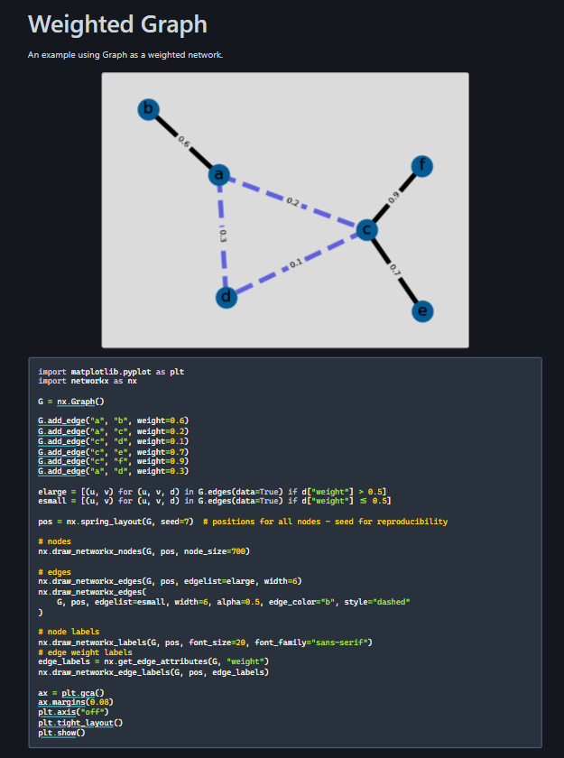
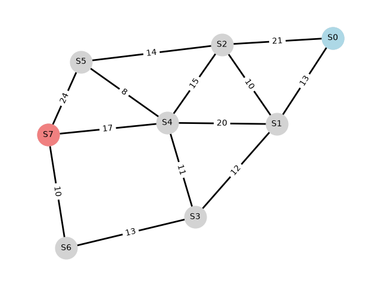
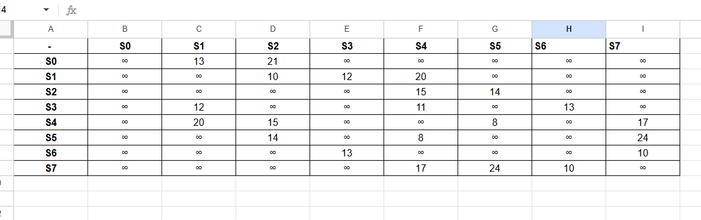
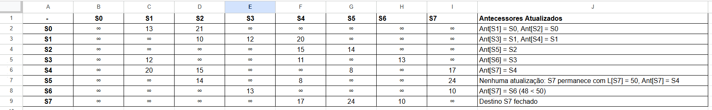
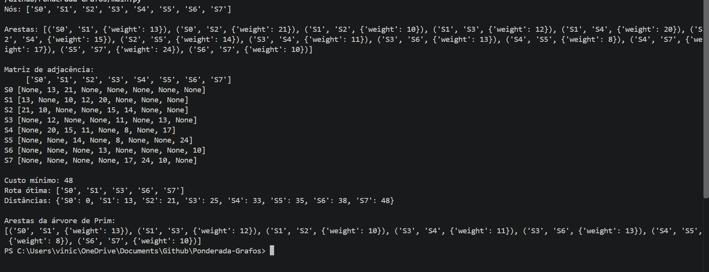

# Atividade-Ponderada-M8-Grafos

**Nome:** Vinícius Rangel Marques dos Santos
**Turma:** T18
**RA:** A2025.1A.0268

## Tabela de Pesos RA

**D1:** 5  
**D2:**1
**D3:**0
**D4:**2
**D5:**6
**D6:**8 (par, logo o destino é S6) 

Origem parte de **S0**
Destino é **S6**

O print dos pesos é dado pelo print ``print ("Arestas:", list(G.edges(data=True)))``.

- **e1:** **13**
- **e2:**  **21** 
- **e3:** **10** 
- **e4:**  **12** 
- **e5:** **20**
- **e6:** **15** 
- **e7:**  **14**
- **e8:**  **11**
- **e9:**  **13**
- **e10:**  **8**
- **e11** **17**
- **e12** **24**
- **e13** **10**

## Desenvolvimento

Quanto a divisão de tempo na atividade, gastei uma grande parcela consultando a documentação do NetworkX para implementação do código da atividade, o início da atividade é composto pela a importação das bibliotecas utilizadas, no caso ``networkx``(para a construção do grafo e aplicação dos algoritmos de busca) e ```matplotlib``(para a representação gráfica).

As importações e desenvolvimento inicial do código foram feitas através de um tutorial visto de preparação para a aula, por isso a declaração de pesos se destingue da usada na documentação do ``networkx``

## Desenvolvimento da Representação Gráfica do Grafo

Foi feito através de código após a declaração dos nós, arestas e pesos a partir da parametrização do RA. Foi escolhido como parâmetro de referência o seguinte código encontrado na documentação da biblioteca ``networkx``, para a implementação eu desconsiderei a regra de linha tracejada e não tracejada definida no código de origem, pois aqui não fazia sentido, e ajustei o layout dos nós para melhor representação. O nó de origem (S0) obteve a cor azul e o nó de destino (s7) obteve a cor vermelha.

**Referência Utilizada para o código para representação gráfica**


**Representação Gráfica do Grafo Proposto**


**Tabela de Pesos**


## Teste de Mesa Tabular de Djkistra



## Implementação de Djkistra e Prim

É setada a matriza de adjascência inicialmente e logo após são mplementadas as funções de busca ``Djkistra`` e ``Prim`` através das funções fornecidas no slack. Segue o resultado do print no terminal:



O resultado do teste com a função implementada foi compatível com o teste tabular do algoritmo de Dijkstra a partir de S0. A ordem de fechamento dos vértices foi S0, S1, S2, S3, S4, S5, S6 e S7, pois as respectivas menores distâncias acumuladas foram 0, 13, 21, 25, 33, 35, 38 e 48.